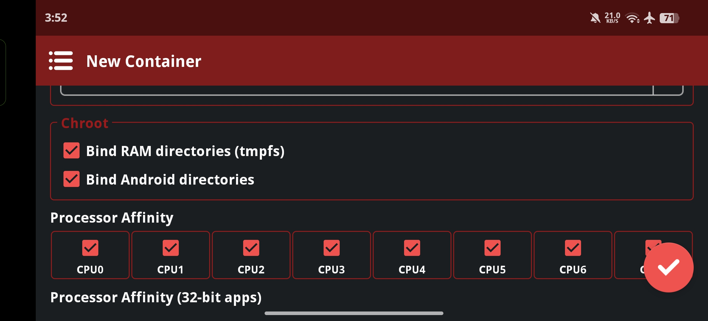

  
  
  

# Root Winlator

Winlator without the PRoot layer.

# What is Root Winlator?

Root Winlator is a fork of Winlator with a small change that makes a real difference in performance.

It does not use PRoot, a userspace implementation of `chroot` and `mount`. Instead, it uses the real `chroot` and `mount` provided by the Linux kernel, which require root privileges. That is why it is called "Root" Winlator: the app depends on root access.

# How does Root Winlator work?

Regular Winlator relies on `proot`, which emulates `chroot` (changing the root directory) and `mount` (creating mount points) in userspace. PRoot traces processes with `ptrace`, intercepts their system calls, and rewrites syscall arguments and results by modifying the tracee's CPU registers so that paths appear translated.

PRoot is widely used in container tools and Android Linux environments. Its goal is to run Linux containers without root. Winlator uses an Ubuntu-based rootfs.

The idea is simple: remove `proot` and replace it with real `chroot` and `mount`.

# Features

Better performance: removing the PRoot layer eliminates `ptrace` syscall interception overhead, which can improve performance, especially for syscall-heavy workloads such as file I/O, even if the difference is small. `tmpfs` is also mounted on `/tmp` and `/dev/shm`, so temporary files are stored in RAM instead of on disk.

# Changes

- Renamed the app to Root Winlator
- Changed the app theme to red
- Removed PRoot and replaced it with `chroot` and `mount`
- Added runtime download of BusyBox to provide `chroot` and `mount`
- Added a chroot section with two new options in the container settings:
  - **Bind RAM directories (tmpfs)**: mounts `tmpfs` on `/tmp` and `/dev/shm`
  - **Bind Android directories**: bind-mounts Android directories such as `/storage` and `/data` into the container

Note: mount points are removed automatically when you exit the container or close the app.

# Requirements

- **Root:** root access is mandatory, because `chroot` and `mount` require it
- **Regular Winlator:** the official Winlator app must be installed on your device

# Warning

Do not uninstall the app before deleting all containers. Containers are not stored in the app's data directory but in `/data/local/tmp/root-winlator`.

Manually deleting `/data/local/tmp/root-winlator/` while mount points are still active can destroy data on your device, because the deletion follows the bind mounts into real Android directories.

The correct way is to delete all containers from within the app. The rootfs is then removed and the mount points are unmounted safely.

## Installation
You can download and install *Root Winlator* via one of the following methods:
**GitHub Releases**: Download the latest APK from the [Releases page](https://github.com/YasserNull/root-winlator/releases).

## License
*Root Winlator* is licensed under the [GNU Lesser General Public License v2.1](LICENSE).

# Credits and Third-party apps

- GLIBC Patches by [Termux Pacman](https://github.com/termux-pacman/glibc-packages)
- Wine ([winehq.org](https://www.winehq.org/))
- Box86/Box64 by [ptitseb](https://github.com/ptitSeb)
- Mesa (Turnip/Zink/VirGL) ([mesa3d.org](https://www.mesa3d.org))
- DXVK ([github.com/doitsujin/dxvk](https://github.com/doitsujin/dxvk))
- VKD3D ([gitlab.winehq.org/wine/vkd3d](https://gitlab.winehq.org/wine/vkd3d))
- CNC DDraw ([github.com/FunkyFr3sh/cnc-ddraw](https://github.com/FunkyFr3sh/cnc-ddraw))
- Libsu by [topjohnwu](https://github.com/topjohnwu) [libsu](https://github.com/topjohnwu/libsu)
- BusyBox binary by [YasserNull](https://github.com/YasserNull) [ndk-box-kitchen](https://github.com/YasserNull/ndk-box-kitchen)
- Distro chroot launching algorithms from [chroot-distro](https://github.com/Magisk-Modules-Alt-Repo/chroot-distro) by [YasserNull](https://github.com/YasserNull)

Special thanks to all the developers involved in these projects. 
Thank you to all the people who believe in this project.

## Donate
Donate if you’d like to support me :)

[**Ko-fi**](https://ko-fi.com/yassernull)
